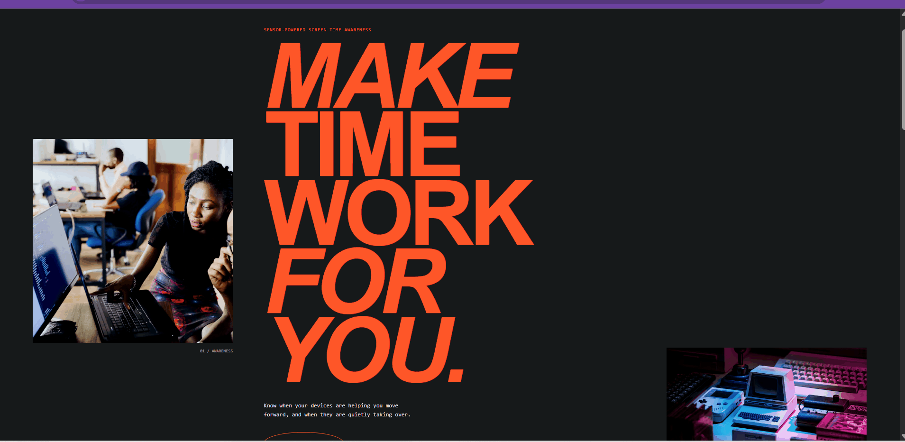
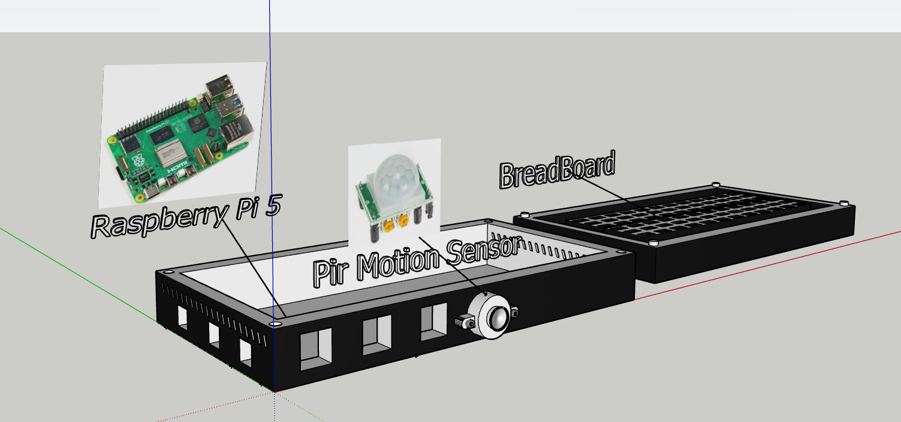
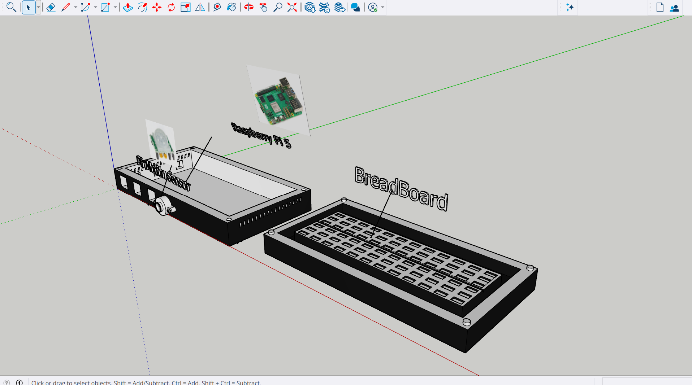

# AntiBurnout

## Introduction 
For our group project in UDP/IoT we have went with the idea where we measure the time spent on computers and give notifications to help users take more breaks via using raspberry PI 5 with PIR Motion sensor and a Pressure sensor. 

## Why we went with this Idea? 
The reason we went with this idea is that people who spend long periods on computers can forget to take breaks due to being focused on work or studies.
Which can lead to tired eyes, exhaustion, irritablility. So thats why we went with this idea so it can remind people to take regular breaks, stretch, move around and rest
their eyes while using a computer, imporving more healthier habits.

## Hardware Required
- Raspberry Pi 5
- USB C Power Supply
- Pio buzzer
- Motion Sensor
- Pressure sensor
- MicroSD card
- Resistors - 220R and 10K
- 5MM LED
- Female to Male wires
- Male to Male wires
- Breadboard
- MCP3008

## Case Design
### Application Used - Sketchup

